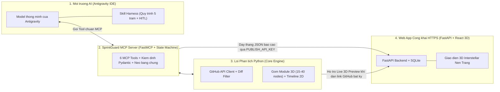
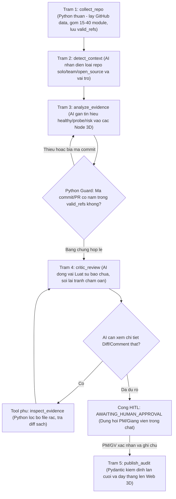

# TÀI LIỆU TỔNG QUAN HỆ THỐNG: VKU SPRINTGUARD

**Phiên bản:** 1.0 (Bản chốt kiến trúc sản phẩm)  
**Ngày cập nhật:** 23/11/2026  
**Định hướng đề tài:** Pathway 3 — Giải quyết nhu cầu vận hành thực tế tại VKU (hỗ trợ giảng viên và nhóm sinh viên kiểm toán đồ án IT)  
**Mô hình phát triển:** 1 Human PM (Sinh viên) + Đội ngũ AI Agents (Antigravity)  

---

## 1. Tầm nhìn, Định vị & Tách bạch 2 lớp

### 1.1. Tách bạch rõ 2 lớp độc lập
Để không nhầm lẫn giữa **cách chúng ta làm dự án** và **chức năng của phần mềm tạo ra**, tài liệu này tách rõ hai lớp:

1. **Lớp 1 — Quy trình quản trị dự án (theo `Project-Guidelines.md`):**  
   Là bộ luật quản trị áp lên chính quá trình bạn (vai trò *Project Manager / Project Lead*) điều phối các AI Agent (Architect, Backend, Frontend, QA, Reviewer) xây dựng nên `VKU SprintGuard`. Lớp này tuân thủ chuẩn GitHub Ecosystem (Issues, GitHub Projects 5 cột, Branch Protection, Conventional Commits, Pull Requests, GitHub Actions CI, Release tag `v1.0.0`), deploy qua HTTPS công khai và hoàn thiện đủ 8 tài liệu Evidence Package.
2. **Lớp 2 — Nghiệp vụ sản phẩm `VKU SprintGuard` (trọng tâm của tài liệu này):**  
   Là phần mềm giúp **Giảng viên / Hội đồng / PM** nhìn rõ sức khỏe và tính chân thực của một GitHub Repository đồ án thông qua **AI đánh giá có bằng chứng + Đồ thị 3D trực quan tối giản**.

### 1.2. Triết lý cốt lõi: *Decision Support System* (Không chấm điểm cứng 0–100)
Thay vì làm một "máy chấm điểm cứng" dễ gây tranh cãi và chấm oan, `VKU SprintGuard` hoạt động như **máy chụp X-Quang kèm trợ lý chẩn đoán**:

- **Vì sao KHÔNG chấm điểm cứng 0–100?**
  - Một dự án **1 người làm (Solo)** sẽ không có *Peer Review* từ thành viên khác hay *Bus Factor* cân bằng — máy chấm cứng sẽ trừ oan.
  - Một dự án **1 người làm chính, vài người khác commit sửa lỗi nhỏ** hoặc **có thành viên phụ trách tài liệu/thiết kế UI/kiểm thử** sẽ bị đo sai nếu chỉ dựa vào số dòng code.
- **Cách `VKU SprintGuard` giải quyết:**
  1. **Nhận diện ngữ cảnh trước (*Context Detection*):** Phân loại repo là `solo`, `student_team`, hay `open_source` và nhận diện vai trò thực tế của từng thành viên trước khi đánh giá.
  2. **Gắn 3 mức tín hiệu trực quan thay cho điểm số:**
     - **Healthy (Bình thường — Giữ đơn sắc trắng đen):** Tiến độ, phân bổ hoặc quy trình ổn định.
     - **Probe (Cần Giảng viên hỏi thêm — Vàng hổ phách):** Điểm đáng lưu ý nhưng chưa chắc là lỗi (ví dụ: 1 commit rất lớn nhưng có thể là import dữ liệu hoặc cấu hình khung dự án) — gợi ý câu hỏi để Giảng viên kiểm chứng khi vấn đáp.
     - **Risk (Cảnh báo rủi ro rõ rệt — Đỏ tín hiệu):** Bất thường rõ ràng có bằng chứng (ví dụ: dồn phần lớn code sát hạn, thiếu kiểm thử hoàn toàn ở module lõi, churn code cao bất thường).
  3. **Sinh sẵn Câu hỏi phỏng vấn theo từng thành viên:** Giúp Giảng viên nhìn màn hình 30 giây là biết nên hỏi xoáy thành viên nào, vào đoạn code/PR nào.

---

## 2. Kiến trúc Tổng thể (Cách 1: Antigravity Brain qua MCP + Web Dashboard HTTPS)

Hệ thống được thiết kế theo mô hình **1 Lõi Python duy nhất — 2 Kênh tương tác**:
- **Kênh AI chuyên sâu (MCP Harness + Antigravity):** Kết nối **Antigravity** (tận dụng các model suy luận mạnh có sẵn trong Antigravity, **0 đồng phí API**) thông qua **MCP Server** và **State-Machine Harness** do chúng ta tự xây dựng.
- **Kênh Web Công khai (HTTPS Dashboard):** Triển khai công khai trên Internet cho Giảng viên và Hội đồng mở trực tiếp trên trình duyệt — vừa xem các bản **Deep AI Audit** đã được xuất bản, vừa hỗ trợ **Live 3D Preview** khi dán bất kỳ link GitHub Repo công khai nào.



### Giải trình Quyết định Kiến trúc (Liên hệ CR-001 trong QLDA)
- **Phương án ban đầu cân nhắc:** Dùng `LangGraph` chạy trên server gọi `Groq API` (Llama 8B/70B free tier).
- **Lý do chuyển sang Cách 1 (CR-001):** Model miễn phí trên Groq có giới hạn lượt gọi (rate limit) và độ sâu suy luận khi đọc Git Diff phức tạp chưa bằng các model mạnh trong Antigravity. Chuyển sang kiến trúc **MCP Harness + Antigravity** giúp giữ được trí tuệ phân tích sâu với **chi phí API bằng 0**, không dính lỗi `429 Rate Limit` khi demo, đồng thời vẫn đáp ứng trọn vẹn cổng kiểm duyệt web HTTPS của môn học nhờ tách riêng phần tính toán & trực quan hóa 3D chạy trực tiếp trên Web.

---

## 3. Khuôn mẫu AI Harness (State Machine 5 Trạm + Critic + HITL)

Thay vì để AI trả lời tự do chỉ với một câu prompt, **Agent Harness** đóng vai trò "đường ray và nhân viên gác cổng" ép Antigravity đi qua đúng **5 Trạm kiểm soát** có trạng thái lưu theo từng `session_id`:



### 3 cơ chế khóa an toàn bên trong Harness
1. **State Machine bắt buộc thứ tự:** Trạng thái phiên audit đi qua các mốc `COLLECTED` → `CONTEXT_SET` → `FINDINGS_SUBMITTED` → `AWAITING_HUMAN_APPROVAL` → `PUBLISHED`. Nếu AI gọi nhảy cóc (ví dụ chưa qua Trạm 4 & HITL mà đòi gọi `publish_audit`), MCP Server từ chối và trả thông báo lỗi hướng dẫn bước hợp lệ.
2. **Evidence Grounding (Chống AI bịa đặt):** Khi Trạm 1 lấy dữ liệu từ GitHub, Python lưu toàn bộ danh sách `commit_sha` và `pr_number` có thật vào `valid_refs`. Ở Trạm 3, mọi tín hiệu `probe` hoặc `risk` AI nộp lên bắt buộc phải đính `evidence_ref` nằm trong `valid_refs` — nếu AI tự nghĩ ra mã commit giả, Python chặn ngay lập tức.
3. **Critic Review + Human-in-the-Loop (HITL):**
   - **Critic Review (Trạm 4):** Ép AI tự lật ngược lại giả định của Trạm 3 (ví dụ: người viết ít dòng code nhưng lại viết toàn bộ unit test hoặc review 15 PR thì phải giải oan). Nếu nghi ngờ 1 commit lớn là file thư viện tự sinh, AI gọi `inspect_evidence` để đọc diff thật.
   - **HITL Checkpoint:** Sau Trạm 4, hệ thống khóa trạng thái ở `AWAITING_HUMAN_APPROVAL`. Antigravity **bắt buộc dừng lại**, tóm tắt các phát hiện ra khung chat để bạn (PM/Giảng viên) duyệt hoặc điều chỉnh (ví dụ: *"Bỏ qua cảnh báo ở thư mục mock data"*) trước khi gọi `publish_audit`.

---

## 4. Đặc tả MCP Server (`sprintguard-mcp`) — 6 Tools & Dữ liệu JSON

### 4.1. Bảng 6 Công cụ MCP
MCP Server viết bằng Python (`FastMCP`), gắn kèm 1 file hướng dẫn quy trình (`SKILL.md`) để Antigravity nhận diện và vận hành đúng chuẩn:

| STT | Tên Tool MCP | Trạm | Đầu vào chính | Nhiệm vụ & Khóa bảo vệ (Harness Guard) |
| :---: | :--- | :---: | :--- | :--- |
| **1** | `start_repo_audit` | Trạm 1 | `repo_url` | Python gọi GitHub API lấy lịch sử commits, contributors, PRs, reviews, CI status; gom file thành **15–40 module**; dựng dữ liệu Timeline 2D; lưu `valid_refs`; cấp `session_id`. |
| **2** | `submit_context` | Trạm 2 | `session_id`, `repo_type`, `member_roles` | Nhận phân loại ngữ cảnh (`solo` / `student_team` / `open_source`) và vai trò từng thành viên. Khóa: kiểm tra xong Trạm 1 & đúng enum Pydantic. |
| **3** | `submit_findings` | Trạm 3 | `session_id`, `signals` | Nhận danh sách tín hiệu `healthy`/`probe`/`risk` gắn vào `node_id`. Khóa: kiểm tra mọi `evidence_ref` của `probe`/`risk` đều tồn tại trong `valid_refs`. |
| **4** | `inspect_evidence` | Hỗ trợ 3–4 | `session_id`, `target_type`, `target_id` | Lấy chi tiết Git Diff hoặc PR review comments thật của một commit/PR cụ thể. Khóa: tự động loại bỏ file lock (`package-lock.json`, `uv.lock`, file build/min.js) để không làm tràn ngữ cảnh AI. |
| **5** | `submit_critic_review` | Trạm 4 | `session_id`, `adjustments`, `draft_summary` | Nộp kết quả phản biện của *Luật sư bào chữa* (giữ nguyên, hạ mức hoặc nâng mức tín hiệu) và bản nháp tóm tắt. Khóa: chuyển phiên sang `AWAITING_HUMAN_APPROVAL` và trả chỉ thị buộc AI hỏi ý kiến con người. |
| **6** | `publish_audit` | Trạm 5 | `session_id`, `human_notes`, `interview_questions`, `final_summary` | Chỉ chạy được sau khi đã ở trạng thái `AWAITING_HUMAN_APPROVAL` và có xác nhận của người dùng. Kiểm định toàn bộ schema bằng Pydantic và **đẩy thẳng JSON qua HTTP POST lên Web App** (không xuất file JSON dự phòng trên máy), trả về đường link xem trực tiếp bản đồ 3D. |

### 4.2. Cơ chế Bảo mật & Đồng bộ dữ liệu lên Web
- Web Backend (FastAPI) mở endpoint `POST /api/audits` được bảo vệ bằng header xác thực chứa **`PUBLISH_API_KEY`** cấu hình trong biến môi trường `.env`.
- Chỉ `sprintguard-mcp` (hoặc người sở hữu key) mới có quyền đăng báo cáo Deep AI Audit mới vào hệ thống.
- Giảng viên, sinh viên và Hội đồng truy cập Web Dashboard ở chế độ công khai: xem tự do toàn bộ báo cáo đã xuất bản và có thể dán link GitHub công khai bất kỳ vào ô tìm kiếm để chạy **Live 3D Preview** tức thì.

### 4.3. Cấu trúc JSON chuẩn cho Web 3D

```json
{
  "audit_id": "aud_9f2a1c",
  "created_at": "2026-11-23T14:00:00Z",
  "mode": "deep_ai_audit",
  "repo": {
    "name": "vku-sprintguard",
    "url": "https://github.com/owner/vku-sprintguard",
    "context": "student_team",
    "context_reasoning": "Repo co 1 thanh vien chinh va 2 cong tac vien ho tro kiem thu, tai lieu."
  },
  "summary": {
    "overview": "Nhip do commit trai deu qua 2 Sprint, co PR va GitHub Actions CI day du...",
    "human_notes": "PM xac nhan thu muc seed_data dung du lieu mau cho demo nen khong tinh la churn bat thuong."
  },
  "graph_3d": {
    "nodes": [
      {
        "id": "author:user-a",
        "type": "author",
        "label": "Nguyen Van A",
        "role": "PM / Backend",
        "size": 42,
        "status": "healthy"
      },
      {
        "id": "mod:backend/api",
        "type": "module",
        "label": "backend/api",
        "size": 1240,
        "churn": 18,
        "status": "probe"
      }
    ],
    "edges": [
      {
        "source": "author:user-a",
        "target": "mod:backend/api",
        "weight": 24
      }
    ]
  },
  "timeline_2d": [
    {
      "week": "2026-W42",
      "commits": 12,
      "additions": 450,
      "deletions": 80,
      "anomaly": false
    }
  ],
  "signals": [
    {
      "id": "sig_01",
      "node_id": "mod:backend/api",
      "level": "probe",
      "title": "PR lon thieu kiem thu don vi bo sung",
      "description": "PR #14 thay doi 380 dong logic xu ly GitHub API nhung chi co 1 file test co ban.",
      "evidence_ref": "PR#14",
      "critic_note": "Da kiem tra diff: code viet theo module sach se, khong phai code copy-paste, giu o muc can hoi them khi bao ve."
    }
  ],
  "interview_questions": [
    {
      "author_id": "author:user-a",
      "author_name": "Nguyen Van A",
      "question": "Trong PR #14, ban xu ly gioi han rate limit cua GitHub API theo co che nao?",
      "evidence_ref": "PR#14"
    }
  ]
}
```

---

## 5. Thiết kế Giao diện Web 3D (*Interstellar Light Minimalism*)

### 5.1. Ngôn ngữ Thiết kế & Hệ thống Màu / Chữ
- **Cảm hứng thị giác:** Bảng điều khiển phi thuyền tối giản kiểu *Interstellar / NASA technical blueprint* trên **nền trắng sáng**, tối ưu độ tương phản khi trình chiếu bằng máy chiếu ở phòng bảo vệ.
- **Kỷ luật màu sắc (95% Đơn sắc Trắng Đen — 5% Màu nhấn ngữ nghĩa):**
  - **Nền chính:** Trắng tinh (`#FFFFFF`), vùng phụ xám rất nhạt (`#FAFAFA`), lưới tọa độ quỹ đạo mảnh (`#E4E4E7`).
  - **Chữ & Đường nét:** Đen mực (`#09090B`), chữ phụ xám đá (`#52525B`), đường viền kỹ thuật mảnh `1px` sắc nét, không dùng hiệu ứng phát sáng neon hay gradient cầu vồng.
  - **Màu nhấn *(chỉ hiện khi thật sự cần thiết)*:**
    - `healthy`: Giữ hoàn toàn **Trắng – Đen – Xám**.
    - `probe` (Cần hỏi thêm): **Vàng hổ phách** (`#D97706`).
    - `risk` (Cảnh báo rủi ro): **Đỏ tín hiệu** (`#DC2626`).
- **Typography:**
  - **`Montserrat`:** Dùng cho tiêu đề, tên dự án, nhãn khu vực, và các con số telemetry kích thước lớn.
  - **`Inter`:** Dùng cho phần giải thích của AI, câu hỏi phỏng vấn, danh sách commit/PR; bật `tabular-nums` cho toàn bộ cột số liệu.

### 5.2. Kiểu đồ thị 3D: Kiểu A — *Clustered 3D Network* (15–40 Nodes)
Để tuyệt đối tránh **Hairball Problem** (mạng nhện file lẻ rối rắm), đồ thị chỉ hiển thị đúng 2 loại node đã được gom cụm ở cấp độ Module:

| Thành phần | Mã hóa hình khối *(Visual Encoding)* | Ý nghĩa trực quan |
| :--- | :--- | :--- |
| **Thành viên (`author`)** | Khối đa diện màu đen (`#09090B`) | Cỡ khối tỷ lệ nhẹ theo mức độ hoạt động; nổi bật giữa nền trắng. |
| **Module chính (`module`)** | Hình cầu (`sphere`) | Đường kính tỷ lệ theo lượng code/số lần chạm; màu trắng viền đen nếu ổn định, chuyển **Vàng** hoặc **Đỏ** nếu có tín hiệu cần chú ý. |
| **Đường nối (`edge`)** | Đường thẳng xám mảnh (`#D4D4D8`) | Thành viên từng sửa Module nào thì nối dây tới Module đó; sửa càng nhiều dây càng đậm/rõ. |

### 5.3. Bố cục 1 màn hình (*Mission Control*) & Các tương tác chính

```text
+----------------------------------------------------------------------------+
| TOP BAR (Nen trang, vien den manh 1px):                                    |
| VKU SPRINTGUARD  | [Chon Ban Audit / Dan Link GitHub -> Live 3D] | [X-Ray] |
+----------------------------------------------+-----------------------------+
|                                              | SIDE INSPECTOR (34%)        |
|        KHONG GIAN GRAPH 3D (66%)             |                             |
|    (Nen trang + vong quy dao manh #E4E4E7)   | [Tong quan] [Node] [Hoi GV] |
|                                              |                             |
|    [Khoi da dien den: Thanh vien]            | - Ngu canh: Solo / Team     |
|          |                                   | - Tom tat AI + Ghi chu PM   |
|    (Hinh cau: Module chinh)                  | - Tin hieu Probe / Risk     |
|                                              |   (Bam vao la Camera 3D     |
|    [Reset Camera]  [Loc theo Thanh vien]     |    tu bay thang toi Node!)  |
+----------------------------------------------+ - Cau hoi van dap tung      |
| TIMELINE 2D (Dai mong duoi cung):            |   thanh vien kem link PR    |
| Bieu do cot nhip commit theo tuan (den/xam,  |                             |
| chi to do tuan co dau hieu dump bat thuong)  |                             |
+----------------------------------------------+-----------------------------+
```

- **Focus Mode:** Bấm vào tên 1 thành viên → toàn bộ dây nối và module của người khác mờ đi còn ~10% độ rõ, chỉ làm nổi bật vùng sở hữu của đúng người đó.
- **Camera Fly-to:** Giảng viên bấm vào một tín hiệu cảnh báo ở cột bên phải → camera 3D tự động xoay và bay mượt tới đúng Module tương ứng.
- **X-Ray Filter:** Một nút gạt nhanh làm mờ toàn bộ node bình thường, chỉ giữ lại các cụm đang mang tín hiệu 🟡 `probe` và 🔴 `risk`.
- **Chế độ Live 3D Preview:** Khi dán link bất kỳ repo công khai nào trên web, hệ thống gọi thẳng lõi Python chạy tức thì để dựng Graph 3D cấu trúc + Timeline 2D + thống kê sở hữu module mà không cần API key LLM.

---

## 6. Công nghệ (Tech Stack) & Cấu trúc thư mục dự kiến

### 6.1. Công nghệ lựa chọn
- **Backend & Lõi phân tích (`backend/`):** Python 3.11+, **FastAPI**, **Pydantic v2**, **HTTPX** (gọi GitHub REST API với PAT miễn phí nâng hạn mức lên 5.000 req/giờ), **SQLite** (lưu trữ báo cáo audit và lịch sử phiên).
- **MCP Server & Harness (`mcp_server/`):** **FastMCP** (dùng chung trực tiếp thư viện `core/` với FastAPI, không viết trùng logic).
- **Frontend 3D (`frontend/`):** **React 18+**, **TypeScript**, **Vite**, **Tailwind CSS**, **`react-force-graph-3d`** (trên nền Three.js), **Lucide Icons** (nét mảnh 1.5px đơn sắc), Google Fonts (**Montserrat** & **Inter**).
- **Kiểm thử & CI/CD:** `pytest` + `ruff` (Python), `vitest` + `eslint` + `tsc` (Frontend), tự động chạy qua **GitHub Actions** trên mỗi Pull Request.
- **Triển khai HTTPS công khai:** Frontend trên **Vercel** hoặc **Cloudflare Pages**; Backend trên **Render** hoặc **Hugging Face Spaces**.

### 6.2. Cấu trúc thư mục dự kiến

```text
vku-sprintguard/
├── .github/
│   └── workflows/
│       └── ci.yml                  # Chay lint, unit test va build tu dong tren moi PR
├── backend/
│   ├── app/
│   │   ├── main.py                 # FastAPI app + CORS + /health + /api/audits
│   │   ├── core/
│   │   │   ├── github_client.py    # Lay commits, PRs, reviews, CI tu GitHub API
│   │   │   ├── diff_filter.py      # Loc bo lockfiles/build files, giu diff sach
│   │   │   ├── module_clusterer.py # Gom file thanh 15-40 module + tinh Timeline 2D
│   │   │   └── schemas.py          # Pydantic schemas chuan cho Graph 3D & Audit
│   │   └── db/
│   │       └── sqlite_store.py     # Luu va truy xuat Audit Reports
│   └── tests/                      # Unit & Integration tests (pytest)
├── mcp_server/
│   ├── server.py                   # FastMCP server khai bao 6 tools
│   └── harness.py                  # State machine 5 tram + Evidence Grounding Guard
├── skills/
│   └── sprintguard-auditor/
│       └── SKILL.md                # Huong dan quy trinh cho Antigravity
├── frontend/
│   ├── src/
│   │   ├── components/
│   │   │   ├── Graph3DCanvas.tsx   # Khung do thi 3D Interstellar nen trang
│   │   │   ├── Timeline2D.tsx      # Bieu do nhip commit theo tuan
│   │   │   └── SideInspector.tsx   # Bang chi tiet Tong quan / Node / Cau hoi GV
│   │   └── styles/                 # Cau hinh Montserrat + Inter & mau don sac
│   └── package.json
├── docs/                           # Tai lieu QLDA (Charter, WBS, CR, Retro...)
└── README.md
```

---

## 7. Phân tích Điểm mạnh, Điểm yếu & Rủi ro kỹ thuật

### 7.1. Điểm mạnh nổi bật
1. **Dùng AI thông minh với chi phí 0 đồng:** Tận dụng trực tiếp model mạnh của Antigravity thông qua MCP, không tốn tiền mua API trả phí và không chạm giới hạn rate limit khi demo hoặc chạy phân tích sâu nhiều vòng.
2. **Kiến trúc Agent Harness rõ ràng, không phải "prompt bọc giao diện":** Có State Machine 5 trạm, vòng phản biện **Critic Review**, cơ chế **Evidence Grounding** cấm bịa đặt mã commit, và **Human-in-the-Loop** cho người kiểm soát chốt cuối.
3. **Thẩm mỹ khác biệt & Thực dụng:** Giao diện 3D nền trắng đen tối giản (Montserrat + Inter) giúp nổi bật các điểm cảnh báo Vàng/Đỏ trên nền đơn sắc, chiếu lên máy chiếu sắc nét và không bị rối *Hairball*.
4. **Đáp ứng tốt cả 2 đối tượng người dùng:** Dev/PM chạy Deep Audit ngay trong Antigravity qua MCP; Giảng viên/Hội đồng mở 1 link HTTPS trên trình duyệt là xem và dùng Live 3D Preview được ngay.

### 7.2. Điểm yếu & Phương án xử lý

| Điểm yếu / Rủi ro | Tác động nếu không xử lý | Biện pháp khắc phục trong thiết kế |
| :--- | :--- | :--- |
| **1. Khoảng cách giữa Live Web và Deep AI** | Trên Web công khai, người lạ dán repo mới sẽ chỉ chạy được *Live 3D Preview* (cấu trúc + timeline), chưa tự chạy phần AI phản biện của Antigravity. | Giao tiếp minh bạch theo mô hình **BYOA (Bring Your Own Agent via MCP)**: Web đảm nhiệm phần đo lường & 3D không cần API key; Deep AI chạy qua Antigravity MCP rồi đồng bộ lên Web. |
| **2. Giới hạn GitHub API (60 req/giờ khi không có token)** | Quét liên tiếp nhiều repo có thể bị GitHub chặn tạm thời. | Cấu hình **GitHub PAT (miễn phí)** ở backend để nâng lên **5.000 req/giờ** và giới hạn độ sâu lấy mẫu (tối đa 100 commits + 30 PRs gần nhất). |
| **3. Nguy cơ rối đồ thị 3D nếu repo quá lớn** | Repo có hàng trăm thư mục hoặc hàng chục contributor làm Graph khó nhìn. | Module Clusterer gom cứng ở độ sâu 2 cấp thư mục, giữ ngưỡng **tối đa 40 module lớn nhất** (phần nhỏ gộp vào cụm `other/`) kết hợp Focus Mode và X-Ray Filter. |
| **4. Cold-start khi deploy Backend miễn phí** | Render / Spaces ngủ đông nếu lâu không có truy cập, lần đầu mở web bị chậm 30–50 giây. | Tạo endpoint `/health` hiển thị trạng thái kết nối rõ trên Top Bar; làm nóng server trước khi quay video demo và khi vào ca bảo vệ. |
| **5. Nguy cơ quá tải phạm vi (Scope Creep)** | Làm một mình cả 3D Web, Backend, MCP Harness và 8 file báo cáo rất dễ trễ tiến độ. | Khóa chặt phạm vi 2 Sprint theo MoSCoW: ưu tiên hoàn thiện luồng lõi chuẩn xác, có test tự động và dữ liệu sạch trước khi thêm tính năng phụ. |

---

## 8. Lộ trình 2 Sprint, Hồ sơ QLDA & Bảng thuật ngữ

### 8.1. Phác thảo Lộ trình thực hiện (2 Sprint)
- **Sprint 1 — Lõi Dữ liệu & Đồ thị 3D nền trắng (MVP chạy thật qua HTTPS):**
  - Dựng FastAPI backend kết nối GitHub API, gom module 3D, tính Timeline 2D, lọc diff sạch.
  - Dựng React Frontend phong cách Interstellar (Montserrat + Inter, nền trắng đen) với Graph 3D Kiểu A + Timeline 2D + Live 3D Preview.
  - Thiết lập GitHub Ecosystem chuẩn môn học (Issues, GitHub Projects 5 cột, PR, GitHub Actions CI chạy test tự động).
- **Sprint 2 — MCP Harness, Deep AI Audit & Tự kiểm toán (*Dogfooding*):**
  - Viết `sprintguard-mcp` (6 tools + State Machine + Evidence Grounding + HITL) và `SKILL.md` tích hợp vào Antigravity.
  - Bổ sung Side Inspector trên Web (hiển thị nhận định AI, ghi chú Critic, ghi chú PM từ HITL, câu hỏi vấn đáp + Camera Fly-to + X-Ray).
  - **Dogfooding:** Dùng chính Antigravity + `sprintguard-mcp` kiểm toán ngược lại repo `vku-sprintguard`, đẩy báo cáo thật lên Web làm bằng chứng cho hồ sơ bảo vệ và quay video demo.

### 8.2. Danh mục 8 Tài liệu Nộp Drive (theo `Project-Guidelines.md`)
Song song với code, dự án hoàn thiện đủ 8 file trong thư mục Google Drive công khai:
1. `01_Final_Technical_Report.pdf` (15–25 trang, 7 chương, viết ở thì quá khứ)
2. `02_Project_Charter_Signed.pdf` (13 mục PMBOK, minh bạch mô hình 1 Human PM + AI Agents)
3. `03_WBS_and_WBS_Dictionary.pdf` (chuẩn 100% Rule)
4. `04_Risk_Register_Evolution.xlsx` (cập nhật qua Sprint 1 & Sprint 2)
5. `05_Sprint_Retrospectives.pdf` (Sprint 1 Retro & Final Retro)
6. `06_Scope_Change_Control_Record.pdf` (ghi nhận CR-001 chuyển từ LangGraph/Groq sang MCP Harness + Antigravity)
7. `07_Stakeholder_Acceptance_Signoff.pdf` (UAT từ người dùng thử nghiệm thực tế tại VKU)
8. `08_Presentation_Slide_Deck.pdf` (8–10 slides cho buổi bảo vệ 16 phút)

### 8.3. Bảng thuật ngữ (Glossary cho quá trình vừa làm vừa học)

| Thuật ngữ | Giải thích ngắn gọn, dễ hiểu |
| :--- | :--- |
| **MCP *(Model Context Protocol)*** | Chuẩn giao tiếp giúp kết nối các công cụ/hàm Python bạn tự viết vào trong Antigravity hoặc các AI IDE khác. |
| **Agent Harness** | "Khung điều khiển" bọc quanh AI: quy định thứ tự các bước chạy, kiểm tra đầu ra và chặn AI làm sai quy trình. |
| **State Machine** | Máy trạng thái: cơ chế nhớ AI đang ở trạm nào để buộc hoàn thành đúng thứ tự từ Trạm 1 đến Trạm 5. |
| **Deterministic vs. Semantic** | *Deterministic* là tính bằng công thức toán học (chạy 100 lần ra 1 kết quả); *Semantic* là dùng AI đọc hiểu ngữ nghĩa code và bối cảnh. |
| **Decision Support System** | Hệ thống hỗ trợ ra quyết định: cung cấp số liệu và bằng chứng trực quan để con người chốt đánh giá công bằng thay vì máy phán điểm cứng. |
| **Evidence Grounding** | Neo bằng chứng: buộc mọi nhận định của AI phải gắn kèm mã commit hoặc số PR có thật trong dữ liệu GitHub. |
| **Pydantic Schema Validation** | Cơ chế kiểm tra chặt cấu trúc JSON bằng Python để đảm bảo dữ liệu trả ra không bị thiếu trường hay làm lỗi giao diện Web. |
| **Human-in-the-Loop (HITL)** | Điểm dừng giữa quy trình để con người kiểm tra, chỉnh sửa giả định hoặc phê duyệt trước khi AI xuất kết quả cuối. |
| **Git Diff** | Phần chi tiết hiển thị từng dòng code vừa được thêm mới hoặc xóa bỏ trong một commit hay Pull Request. |
| **Bus Factor** | Độ rủi ro phụ thuộc nhân sự (ví dụ cả dự án chỉ 1 người hiểu/viết phần lõi thì `Bus Factor = 1`). |
| **Mega-PR** | Pull Request có quá nhiều dòng thay đổi gộp chung 1 lúc, khiến việc đọc kiểm tra rất khó và dễ lọt lỗi. |
| **Code Churn** | Hiện tượng một tệp/đoạn code vừa viết xong lại bị sửa đi sửa lại hoặc xóa liên tục trong thời gian ngắn. |
| **Hairball Problem** | Hiện tượng đồ thị vẽ quá nhiều đỉnh và dây nối đan xen thành một cục rối mù không đọc được thông tin. |
| **Progressive Disclosure** | Hé lộ thông tin theo tầng: màn hình chính giữ thật thoáng, bấm sâu vào từng đối tượng mới hiện chi tiết. |
| **Visual Encoding** | Dùng hình khối, kích thước và màu sắc một cách có quy ước rõ ràng để truyền đạt thông tin nhanh mà không cần đọc nhiều chữ. |
| **Camera Fly-to** | Hiệu ứng camera trên không gian 3D tự động bay mượt tới đúng node khi người dùng bấm chọn ở danh sách bên cạnh. |
| **Dogfooding** | Dùng chính phần mềm mình tạo ra để kiểm tra và đánh giá ngược lại chính dự án của mình. |
