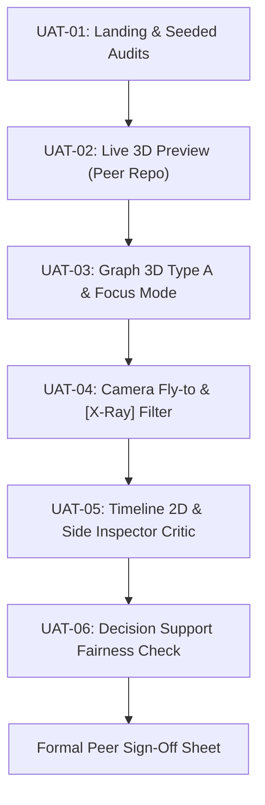

# VKU PEER USER ACCEPTANCE TESTING (UAT) SCRIPT & SIGNOFF TEMPLATE

**Course:** Software Project Management (`Quản trị dự án phần mềm (5)`)  
**Academic Supervisor:** Dr. Nguyen Thanh Tuan / TS. Nguyễn Thanh Tuấn  
**Project Name:** VKU SprintGuard (`VKU-SPM-GUARD`)  
**Project Manager:** Đinh Nhật Cảm (Student ID: `24Ite019`)  
**Sourcing Pathway:** **Pathway 3: Real Campus / Department / Student Organization Need at VKU**  
**Target Stakeholders:** VKU Student Capstone Project Teams (Software Engineering, AI, Web, Mobile) & Course Teaching Assistants  
**Deliverable Document:** Preparation Kit for `07_Stakeholder_Acceptance_Signoff.pdf`  
**Document Version:** Version 1.0 (Final M7 Peer UAT Protocol)  

---

## 1. UAT OVERVIEW & OBJECTIVE

`VKU SprintGuard` is designed as a **Decision Support System ("X-Ray + Diagnostic Assistant")** to help VKU instructors and capstone student teams verify the *Authentic Project Rule* (continuous commit rhythm, balanced module ownership, PR/CI hygiene) without relying on arbitrary 0–100 scores.

This document serves as the formal **Peer User Acceptance Testing (UAT) Script and Sign-Off Protocol**. Peer software engineering teams from concurrent VKU capstone courses will execute hands-on testing on their real repositories using this script and formally sign the acceptance sheet.

---

## 2. PREREQUISITES & LOCALHOST ENVIRONMENT SETUP

Peer evaluators can run VKU SprintGuard entirely locally with zero cloud dependencies.

### 2.1 System Requirements
- OS: Windows 10/11, macOS, or Linux.
- Python: Version `3.11+` (managed via `uv`).
- Node.js: Version `20+` or `22+` (Node 26 LTS compatible).
- Git & GitHub Account (with public repository access).

### 2.2 Dual-Server Startup Procedure

```powershell
# Step 1: Clone repository
git clone https://github.com/NhatCam2006/vku-sprintguard.git
cd vku-sprintguard

# Step 2: Start Backend (Port 8000)
cd backend
$env:GITHUB_TOKEN = (gh auth token) # Optional: higher rate limits
uv run uvicorn app.main:app --host 127.0.0.1 --port 8000

# Step 3: In a second terminal, start Frontend (Port 5173)
cd ../frontend
npm install
npm run dev -- --host 127.0.0.1 --port 5173
```

Open a web browser at **`http://localhost:5173`**. Both servers must be running concurrently.

---

## 3. STRUCTURED UAT TEST SCENARIOS

Each peer tester must execute the following 6 test scenarios and record observations.



---

### Scenario UAT-01: Landing Screen & Seeded Deep Audits Inspection
- **Objective:** Verify initial landing screen, quick audit selection, and instant rendering of pre-seeded audits.
- **Test Steps:**
  1. Navigate to `http://localhost:5173`.
  2. Observe the Landing Screen hero section, project badges, and pre-seeded audit cards (e.g., `aud_deep_01_capstone_healthy`, `aud_deep_02_solo_probe`, `aud_deep_03_commit_dump`).
  3. Click on the pre-seeded audit card `aud_deep_01_capstone_healthy`.
- **Expected Outcome:**
  - Mission Control dashboard opens instantly.
  - 3D Ownership Graph renders in Interstellar Light theme.
  - TopBar shows repository title, mode badge (`DEEP AI AUDIT`), and node/edge counters.
- **Pass / Fail Criteria:** Instant transition (< 500ms), no blank screen or JavaScript console exceptions.

---

### Scenario UAT-02: Live 3D Preview on Peer's Own VKU GitHub Repo
- **Objective:** Verify that peer teams can inspect their real VKU capstone repository on-demand without requiring pre-computed AI tokens.
- **Test Steps:**
  1. Return to the Landing Screen by clicking the logo or "Back" button in TopBar.
  2. In the "Live GitHub Preview" input box, paste the full URL of your team's VKU repository (e.g., `https://github.com/<your-vku-team>/<repo-name>`).
  3. Click **"Run Live Preview"**.
- **Expected Outcome:**
  - System calls `POST http://127.0.0.1:8000/api/preview`.
  - Telemetry parser constructs a 3D ownership graph and 2D commit timeline from live git history.
  - Dashboard transitions into `LIVE PREVIEW` mode showing your team's real authors, modules, and commit cadence.
- **Pass / Fail Criteria:** Telemetry loads within 5–15 seconds; node names match actual repository contributor handles and directory structure.

---

### Scenario UAT-03: 3D Ownership Graph Type A Encoding & Focus Mode
- **Objective:** Verify visual distinction between authors and modules, and evaluate 1st-degree connection isolation.
- **Test Steps:**
  1. In the 3D canvas, identify **Author Nodes** (golden celestial orbs, size proportional to commit volume) and **Module Nodes** (colored planetary spheres, size proportional to churn).
  2. Click on a specific Author Node (e.g., your own GitHub handle or team lead).
- **Expected Outcome:**
  - **Focus Mode** activates: the clicked node and all directly connected modules remain illuminated.
  - Unconnected nodes and edges dim into subtle translucent outlines.
  - TopBar shows a notification or indicator: `Focus Mode Active (Click empty space to reset)`.
  - Clicking empty background resets the graph to full cluster visibility.
- **Pass / Fail Criteria:** Smooth node selection; clear visual contrast between focused and dimmed nodes.

---

### Scenario UAT-04: Camera Fly-to & `[X-Ray]` Signal Filter
- **Objective:** Verify smooth 3D camera pan/zoom into signal nodes and assess diagnostic highlight capabilities.
- **Test Steps:**
  1. Open the **Side Inspector** on the right side of the screen.
  2. Under the **"Audit Signals"** section, locate a signal card marked `probe` or `risk` (or `healthy`).
  3. Click on the signal card.
  4. In the TopBar, click the **`[X-Ray]`** toggle button.
- **Expected Outcome:**
  - Clicking the signal card triggers a smooth **Camera Fly-to**, smoothly centering the 3D camera onto the associated node.
  - Toggling `[X-Ray]` dims all `healthy` nodes to ethereal wireframes, dramatically spotlighting `probe` and `risk` modules.
- **Pass / Fail Criteria:** Camera moves smoothly without abrupt jumps; X-Ray filter toggle responds immediately (< 100ms).

---

### Scenario UAT-05: Timeline 2D Anomaly Scrubbing & Critic / Q&A Inspection
- **Objective:** Verify chronological commit rhythm telemetry, adversarial Critic notes, and defense interview questions.
- **Test Steps:**
  1. Observe the **Timeline 2D telemetry strip** at the bottom of the screen.
  2. Check for highlighted anomaly markers (e.g., sudden commit dumps before milestone deadlines).
  3. In the Side Inspector, scroll down to review:
     - **Adversarial Critic Notes:** Verifying why a signal was kept as `probe` or downgraded to avoid false-positive grading.
     - **Human PM Notes:** Official sign-off statement by the project manager.
     - **Defense Interview Questions:** Evidence-grounded technical questions prepared for oral defense.
- **Expected Outcome:**
  - Weekly commit volumes and additions/deletions display clearly.
  - Critic notes provide contextual defense for student effort.
  - Interview questions reference authentic commit SHAs or PR numbers.
- **Pass / Fail Criteria:** All text is legible, free from placeholder strings, and clearly attributed.

---

### Scenario UAT-06: Decision Support Fairness Check (No 0–100 Score)
- **Objective:** Confirm that VKU SprintGuard operates strictly as an objective Decision Support System and does not issue arbitrary or punitive numerical scores.
- **Test Steps:**
  1. Inspect all screens (Landing, TopBar, 3D Graph, Timeline 2D, Side Inspector).
  2. Search for any automated grade, ranking, or 0–100 composite score.
- **Expected Outcome:**
  - Zero arbitrary 0–100 scores exist.
  - All signals are categorized strictly into objective levels: `healthy`, `probe` (needs clarification), or `risk` (requires mitigation).
  - The tool empowers instructors and students to discuss real engineering evidence during defense.
- **Pass / Fail Criteria:** Verified 100% absence of reductive grading scores.

---

## 4. STAKEHOLDER ACCEPTANCE SIGN-OFF FORM

*(To be printed / compiled into `07_Stakeholder_Acceptance_Signoff.pdf` upon completion of peer testing)*

### Evaluator Team Registry
- **Testing Date:** ________________________
- **Location:** VKU Campus / Software Engineering Lab / Localhost Testbed

| Item | Evaluator 1 (Peer Lead) | Evaluator 2 (Peer Dev/QA) |
| :--- | :--- | :--- |
| **Full Name** | | |
| **Student ID (MSSV)** | | |
| **Class / Cohort** | | |
| **Capstone Project Name** | | |
| **Repository Tested** | | |

---

### Test Scenario Evaluation Matrix

| Scenario ID | Test Scenario Name | Status (Pass / Fail) | Observations & Tester Comments |
| :--- | :--- | :---: | :--- |
| **UAT-01** | Landing Screen & Seeded Deep Audits | `[  ]` PASS / `[  ]` FAIL | |
| **UAT-02** | Live 3D Preview on Peer's Own Repo | `[  ]` PASS / `[  ]` FAIL | |
| **UAT-03** | 3D Graph Type A & Focus Mode | `[  ]` PASS / `[  ]` FAIL | |
| **UAT-04** | Camera Fly-to & `[X-Ray]` Filter | `[  ]` PASS / `[  ]` FAIL | |
| **UAT-05** | Timeline 2D & Critic / Q&A Review | `[  ]` PASS / `[  ]` FAIL | |
| **UAT-06** | Decision Support Fairness (No 0–100 Score) | `[  ]` PASS / `[  ]` FAIL | |

---

### Qualitative Stakeholder Feedback & Usability Assessment

1. **How effectively does the 3D Ownership Graph and Timeline 2D reflect your team's real contribution distribution?**  
   ___________________________________________________________________________________________________  
   ___________________________________________________________________________________________________  

2. **Does the Adversarial Critic defense and lack of a 0–100 score reduce anxiety compared to traditional static code analysis tools?**  
   ___________________________________________________________________________________________________  
   ___________________________________________________________________________________________________  

3. **Suggested improvements or feature requests for VKU SprintGuard v2:**  
   ___________________________________________________________________________________________________  
   ___________________________________________________________________________________________________  

---

### Formal Acceptance Sign-Off Decision

*Select one of the three acceptance categories below:*

- [ ] **ACCEPTED FULLY:** The software satisfies all acceptance criteria across UAT-01 through UAT-06 with zero blocking defects. Ready for formal submission.
- [ ] **ACCEPTED WITH MINOR REMARKS:** Minor non-blocking UX observations noted above; accepted for Milestone M7 closure.
- [ ] **REJECTED:** One or more core scenarios failed. Revision required.

---

### Formal Signatures

| Peer Evaluator 1 (Team Representative) | Peer Evaluator 2 (QA / Developer) | VKU SprintGuard Project Manager |
| :---: | :---: | :---: |
| *(Signature & Full Name)* | *(Signature & Full Name)* | *(Signature & Full Name)* |
| <br><br>__________________________ | <br><br>__________________________ | <br><br>**Đinh Nhật Cảm (`24Ite019`)** |
| Date: ____ / ____ / 2026 | Date: ____ / ____ / 2026 | Date: 25 / 11 / 2026 |
